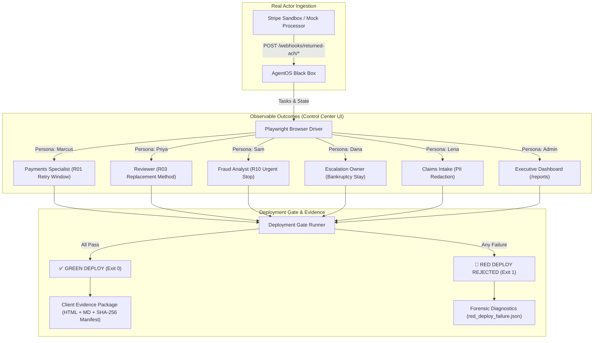

# Return ACH Test Engine

An autonomous, black-box, production-grade **Real-User Evaluation and Deployment Gate Engine** for Returned ACH resolution platforms (AgentOS).

The engine judges the product the way a real user does: from the outside, with zero knowledge of internal code, evaluated strictly against NACHA rules and client requirements. It drives realistic entry points (Stripe / Processor webhooks), acts as human personas in the Control Center UI (Playwright browser automation), verifies visible outcomes, enforces post-deployment quality gates, and generates tamper-proof client evidence packages.

---

## Table of Contents

- [Core Principles & Architecture](#core-principles--architecture)
- [The 4-Phase Delivery Plan](#the-4-phase-delivery-plan)
- [Key Capabilities](#key-capabilities)
- [Project Structure](#project-structure)
- [Installation & Setup](#installation--setup)
- [CLI Commands & Usage](#cli-commands--usage)
  - [1. Deployment Gate (`ach-test gate`)](#1-deployment-gate-ach-test-gate)
  - [2. Real-User Journeys (`ach-test journey`)](#2-real-user-journeys-ach-test-journey)
  - [3. Shell Deployment Script (`./scripts/deploy_gate.sh`)](#3-shell-deployment-script-scriptsdeploy_gatesh)
  - [4. API Contract Fuzzing (`ach-test run`)](#4-api-contract-fuzzing-ach-test-run)
  - [5. API Discovery (`ach-test discover`)](#5-api-discovery-ach-test-discover)
  - [6. Interactive Web Dashboard (`ach-test ui`)](#6-interactive-web-dashboard-ach-test-ui)
- [The 8 Real-User Evaluation Journeys](#the-8-real-user-evaluation-journeys)
- [Deployment Gate & CI/CD Pipeline](#deployment-gate--cicd-pipeline)
- [Client Evidence & Sign-Off Package](#client-evidence--sign-off-package)
- [Safety & Data Integrity Guarantees](#safety--data-integrity-guarantees)
- [Running Self-Tests](#running-self-tests)

---

## Core Principles & Architecture

Following the specification in `Test Engine Handoff: Real-User Evaluation of AgentOS`:

1. **Expectations come from requirements, never from AgentOS code**: Expected outcomes are drawn directly from the client specification and NACHA guidelines.
2. **Enter the way real actors enter**: Returns enter via payment processor webhooks (Stripe sandbox or signed processor webhook). Human users interact with the Next.js Control Center UI (`http://localhost:3000`) driven via Playwright personas.
3. **Judge only what a user can see**: Inboxes, drafted customer notices, suggested retry dates, specialist adjustment ability, customer PII masking, activity timelines, and Reports dashboards.
4. **Test whole journeys, not single requests**: Each journey traces a case from initial return ingestion to final resolution.
5. **Safe by default**: Read-only operations by default, dynamic references per run, dates computed from today, zero modification of shared connector settings.
6. **Report in plain English with screenshot evidence**: Mismatches fail; where requirements are silent, report a question rather than a hard failure.



---

## The 4-Phase Delivery Plan

| Phase | Title | Core Objective | Done When |
|:---:|---|---|---|
| **1** | **Fix the Basics** | Read-only default, exact HTTP status codes, dynamic UUIDs & current dates, removed made-up mock passes. | No false passes; no settings changed. |
| **2** | **First Journeys** | Stripe sandbox driver, Playwright browser driver, Scenario A (`R01`), Scenario B (`R03`), Retry outcome. | Journeys 1 to 3 pass on local stack. |
| **3** | **Full Coverage** | Journeys 4 to 8: Suspected fraud, protected customer bankruptcy, duplicate events, RBAC/privacy masking, executive reporting figures. | All 8 journeys pass; plain-English report. |
| **4** | **Gate and Evidence** | Post-deploy CI gate CLI, strict red deploy failure exit code, client deliverables package with cryptographic manifest and sign-off sheet. | Runs on every deploy; client signs off. |

---

## Key Capabilities

- **100% Real-User Journey Coverage**: Full automated execution of all 8 business journeys across all organizational personas.
- **Automated Deployment Gate**: `ach-test gate` halts red deploys with exit code `1` and outputs actionable forensic failure logs.
- **Client Sign-off Evidence Package**: Generates standalone, self-contained HTML/Markdown reports and an audit manifest with SHA-256 checksums of all screenshots and artifacts.
- **Browser Playwright Automation**: Native browser interactions against the Control Center UI (`http://localhost:3000`) supporting persona switching (`marcus`, `priya`, `sam`, `dana`, `lena`, `admin`).
- **Cryptographic Webhook Signatures**: Ingests realistic return events signed with HMAC-SHA256 (`POST /api/v1/webhooks/returned-ach/mock_processor` and Stripe webhooks).
- **Comprehensive API Contract Testing**: Preserves contract discovery, schema permutations, NACHA domain rules, and error boundary tests.

---

## Project Structure

```text
returned-ach-test-engine/
├── .github/
│   └── workflows/
│       └── deploy-gate.yml         # GitHub Actions post-deploy gate workflow
├── scripts/
│   └── deploy_gate.sh              # Standalone deployment gate shell script
├── test_engine/
│   ├── cli.py                      # Click CLI entrypoint (ach-test gate/journey/run/discover/ui)
│   ├── config.py                   # Engine configuration & environment settings
│   ├── logger.py                   # Structured logging
│   ├── journeys/
│   │   ├── definitions.yaml        # Journey definitions written from requirements
│   │   ├── models.py               # JourneyResult, JourneyStep, Persona, StepStatus
│   │   ├── driver_stripe.py        # Stripe sandbox & signed webhook processor driver
│   │   ├── driver_browser.py       # Playwright browser driver for Control Center UI
│   │   └── runner.py               # Complete 8-journey evaluation orchestrator
│   ├── gate/
│   │   ├── __init__.py
│   │   └── runner.py               # Post-deployment gate runner & red deploy diagnostics
│   ├── reporting/
│   │   ├── client_packager.py      # Client evidence packager (HTML, MD, SHA-256 manifest)
│   │   └── exporters.py            # Console, JSON, Markdown, HTML exporters
│   ├── discovery/                  # OpenAPI spec discovery & contract analysis
│   ├── scenarios/                  # NACHA domain & schema scenario generators
│   ├── execution/                  # Async HTTP client and request runner
│   ├── validation/                 # Strict status and field validator
│   └── server.py                   # Localhost FastAPI web server & UI dashboard
└── tests/
    ├── test_gate.py                # Deployment gate and evidence packager tests
    ├── test_journeys.py            # Journey runner tests
    ├── test_drivers.py             # Stripe and browser driver tests
    ├── test_phase1_compliance.py   # Safety & read-only compliance tests
    └── ...                         # 69 unit & integration tests passing (100%)
```

---

## Installation & Setup

### Prerequisites
- Python >= 3.11
- `uv` package manager (recommended)

### Installation
```bash
git clone https://github.com/ijazahmad9dev/returned-ach-test-engine.git
cd returned-ach-test-engine

# Sync virtualenv and dependencies
uv sync --all-extras

# Install Playwright browser binaries
uv run playwright install --with-deps chromium
```

---

## CLI Commands & Usage

The package installs the `ach-test` executable.

### 1. Deployment Gate (`ach-test gate`)
Runs pre-flight readiness checks, executes the complete 8-journey evaluation, enforces non-zero exit on failure, and packages client evidence:

```bash
# Run against local stack:
uv run ach-test gate --url http://localhost:8000 --ui-url http://localhost:3000

# Run in fail-fast mode (stops immediately upon first failing journey):
uv run ach-test gate --fail-fast

# Specify custom output directory:
uv run ach-test gate -o reports/gate --bundle-client-report
```

### 2. Real-User Journeys (`ach-test journey`)
Executes human-in-the-loop journeys with Playwright browser automation:

```bash
# Run all 8 journeys:
uv run ach-test journey -j all

# Run an individual journey (e.g. Journey 1: Scenario A):
uv run ach-test journey -j 1

# Run with visible browser window (non-headless):
uv run ach-test journey -j 4 --no-headless
```

### 3. Shell Deployment Script (`./scripts/deploy_gate.sh`)
An executable script designed for CI/CD pipelines and deployment hooks:

```bash
# Execute deployment gate with automatic readiness polling:
./scripts/deploy_gate.sh
```

### 4. API Contract Fuzzing (`ach-test run`)
Executes schema validation, NACHA reason code matrix, and error handling tests:

```bash
# Run default read-only contract tests:
uv run ach-test run --url http://localhost:8000

# Run with custom suites:
uv run ach-test run --suites ach_domain --suites schema -f html -f markdown
```

### 5. API Discovery (`ach-test discover`)
Inspects endpoints, parameter requirements, and OpenAPI contracts:

```bash
uv run ach-test discover --url http://localhost:8000
```

### 6. Interactive Web Dashboard (`ach-test ui`)
Launches the localhost web dashboard:

```bash
uv run ach-test ui --port 8080
```

---

## The 8 Real-User Evaluation Journeys

| # | Journey | Persona | How It Starts | Expected Outcome Required by Spec |
|---|---|---|---|---|
| **1** | **Scenario A: Insufficient Funds (`R01`), $89.00** | `marcus` (Payments Specialist) | Failing debit in Stripe sandbox / mock processor | Case reaches Marcus's inbox. Suggests retry 4 business days after return. Drafts notice naming date. Marcus moves date and approves. Handoff to client payment process; AgentOS debits nothing. |
| **2** | **Retry Outcome (Settled vs. Bouncing)** | System / `admin` | Retry of Journey 1's debit (once settling, once failing) | Settled: case marked settled and counted in Reports. Failed again: case reopens for manual handling. |
| **3** | **Scenario B: No Account (`R03`), $125.00** | `priya` (Reviewer) | No-account debit in Stripe sandbox / mock processor | No retry offered. Replacement payment method request drafted (Email/SMS). On approval, case stays open waiting for customer with follow-up task; Priya closes with resolution reason. |
| **4** | **Suspected Fraud (`R10`) on New Account** | `sam` (Fraud Analyst) | Trigger for fraud test account (`TRC-R10-FRAUD`) | Urgent priority at top of Sam's inbox. Retry ruled out; no customer message drafted. Account blocking and stopping future debits offered. Team alerted; Sam opens fraud investigation. |
| **5** | **Protected Customer (Bankruptcy)** | `dana` (Escalation Owner) | Trigger for protected test account (`TRC-PROTECTED`) | Bankruptcy stops case at protection gate before interpretation. Escalates to Dana. Nothing can be approved. Dana closes without action, citing legal/compliance stay reason. |
| **6** | **Duplicate Event Handling** | System | Exact same processor return delivered twice | Deduplicated by processor reference: exactly one case created; second delivery identified as duplicate without duplicate tasks. |
| **7** | **Permissions & Privacy (RBAC)** | `marcus`, `lena`, `sam` | Cross-persona access attempt on open case | Unauthorized roles cannot decide (HTTP 403 `wrong_role`). Roles without identity access (`lena`) see redacted customer name (`[NAME_1]`). Authorized roles (`sam`) view details. |
| **8** | **Executive Reporting** | `admin` | Navigation to `/reports` after journeys 1–6 | Executive metrics reflect live run activity: return rates, settled retries, and recovered dollars accurately aggregated. |

---

## Deployment Gate & CI/CD Pipeline

The gate runner strictly enforces deployment quality:

- **Pass Criterion**: Target API and Control Center UI must be healthy, and 100% of real-user journeys must pass.
- **Fail Criterion ("Fails a Red Deploy")**: If any journey assertion fails, a service is down, or an unexpected exception occurs:
  1. The gate terminates with non-zero exit code `1`.
  2. Forensic diagnostics are emitted to `reports/gate/red_deploy_failure.json` and `reports/gate/red_deploy_failure.md`.
  3. Actionable remediation notes and links to failure screenshots are provided.

### GitHub Actions Workflow (`.github/workflows/deploy-gate.yml`)
Runs automatically on pushes, pull requests, or manual `workflow_dispatch`:
- Sets up Python 3.11 and `uv`.
- Installs Playwright Chromium.
- Executes `pytest` and `./scripts/deploy_gate.sh`.
- Automatically publishes the **Client Evidence Package** as a workflow artifact.

---

## Client Evidence & Sign-Off Package

Generated automatically in `reports/gate/client_package/`:

- **`index.html`**: Interactive, responsive executive report with KPI cards, NACHA compliance scorecard, step-by-step journey audit tables, screenshot previews, open policy questions, and a formal Client Acceptance Sign-Off section.
- **`client_evaluation_report.md`**: Clean, standalone GitHub-flavored Markdown deliverable.
- **`evidence_manifest.json`**: Tamper-proof JSON manifest containing SHA-256 cryptographic hashes for every generated file and screenshot. Run `sha256sum -c evidence_manifest.json` to verify integrity.
- **`screenshots/`**: Portable bundle of Playwright diagnostic screenshots.

### Open Policy Questions (Documented for Client Decision)
1. **R16 & R20 Return Codes**: Unmapped codes currently route to a human reviewer as unknown codes.
2. **Post-Deploy Target Environment**: Formal environment ownership (staging vs production-mirrored sandbox).
3. **Stripe Sandbox Credentials**: Provisioning of isolated test credentials for automated gating.
4. **Report Publishing Destination**: Long-term artifact archive (S3 compliance bucket, CI/CD artifacts, or client portal).

---

## Safety & Data Integrity Guarantees

- **Read-Only by Default**: The test engine never mutates live connector configurations. Mutating operations are restricted behind `--allow-writes`.
- **Fresh Dynamic Identifiers**: Unique UUIDs generated per run (`evt_...`, `trace_...`) prevent stale replay traps.
- **Real-Time Date Calculations**: Dates are dynamically calculated relative to today (`date.today()`), matching AgentOS real-time handling.
- **Origin-Restricted CORS**: The web dashboard restricts CORS to local origin and whitelisted target hosts (`localhost`, `127.0.0.1`).

---

## Running Self-Tests

To execute the unit and integration test suite:

```bash
uv run pytest
```

```text
============================= test session starts ==============================
platform linux -- Python 3.11.15, pytest-9.1.1
collected 69 items

tests/test_config.py ....                                                [  5%]
tests/test_connectors.py ....                                            [ 11%]
tests/test_discovery.py ......                                           [ 20%]
tests/test_drivers.py ....                                               [ 26%]
tests/test_e2e.py ..                                                     [ 28%]
tests/test_execution_validation.py .....                                 [ 36%]
tests/test_gate.py .........                                             [ 49%]
tests/test_graph.py ....                                                 [ 55%]
tests/test_journeys.py ..                                                [ 57%]
tests/test_logger.py ..                                                  [ 60%]
tests/test_phase1_compliance.py ....                                     [ 66%]
tests/test_reporting.py ......                                           [ 75%]
tests/test_scenarios.py ......                                           [ 84%]
tests/test_server.py ...........                                         [100%]

============================== 69 passed in 0.98s ==============================
```
