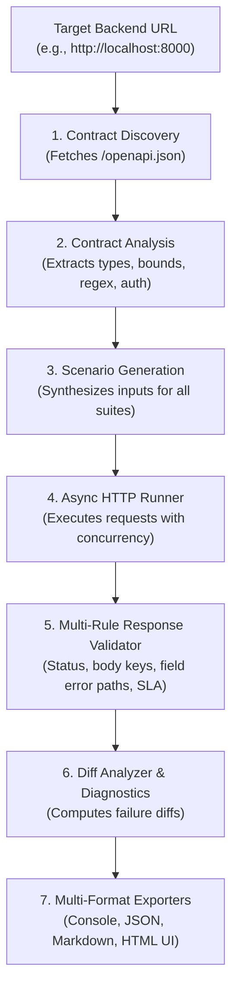
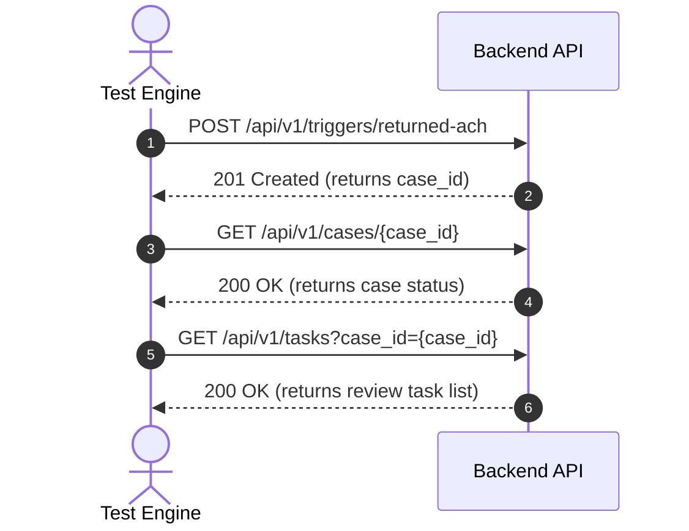

# Return ACH Test Engine - Test Specifications & Data Flow Guide

This document explains **how the test engine works**, what **test suites** are currently executed, and the exact **data that goes in (inputs)** and **data that comes out (outputs)** across all scenarios.

---

## Table of Contents

- [1. How the Engine Works](#1-how-the-engine-works)
- [2. Overview of Test Suites](#2-overview-of-test-suites)
- [3. ACH Domain Suite (`ach_domain`)](#3-ach-domain-suite-ach_domain)
  - [3.1 Valid NACHA Reason Code Matrix](#31-valid-nacha-reason-code-matrix)
  - [3.2 Invalid Reason Codes](#32-invalid-reason-codes)
  - [3.3 Trace Number Shape & Format](#33-trace-number-shape--format)
  - [3.4 Settlement Date Thresholds](#34-settlement-date-thresholds)
  - [3.5 Idempotency & Deduplication Replay](#35-idempotency--deduplication-replay)
- [4. Generic Schema Validation Suite (`schema`)](#4-generic-schema-validation-suite-schema)
  - [4.1 Baseline Valid Payloads](#41-baseline-valid-payloads)
  - [4.2 Missing Required Fields](#42-missing-required-fields)
  - [4.3 Invalid Data Types](#43-invalid-data-types)
  - [4.4 Boundary & Constraint Violations](#44-boundary--constraint-violations)
  - [4.5 Strict Extra Fields Rejection](#45-strict-extra-fields-rejection)
- [5. Stateful Lifecycle Flow Suite (`lifecycle`)](#5-stateful-lifecycle-flow-suite-lifecycle)
- [6. Security & Error Handling Suite (`security` / `error_handling`)](#6-security--error-handling-suite-security--error_handling)
- [7. Upstream Connector Suite (`connectors`)](#7-upstream-connector-suite-connectors)
- [8. Health & Connectivity Suite (`health`)](#8-health--connectivity-suite-health)
- [9. How Responses Are Validated (Output Assertions)](#9-how-responses-are-validated-output-assertions)

---

## 1. How the Engine Works

The test engine operates autonomously using a multi-phase **LangGraph** pipeline:



1. **Discovery**: Queries the target's `/openapi.json` to find all paths, parameters, schemas, and security requirements.
2. **Analysis**: Dereferences `$ref` schemas and extracts field constraints into validation rules (types, formats, lengths, patterns).
3. **Generation**: Creates targeted test cases covering valid baseline data, boundary violations, negative tests, and domain workflows.
4. **Execution**: Sends requests over HTTP with configurable concurrency and retry limits.
5. **Validation**: Compares the server's actual HTTP status, JSON body, field error paths, and response time against expected criteria.
6. **Reporting**: Summarizes outcomes in terminal tables, downloadable reports, and an interactive web dashboard.

---

## 2. Overview of Test Suites

| Suite Name | Target Area | What It Validates |
|---|---|---|
| `health` | Target reachability | Basic HTTP availability and health endpoints (`/api/v1/health`) |
| `schema` | OpenAPI contract conformance | Type checking, required fields, string length, regex constraints, strict extra fields |
| `ach_domain` | NACHA banking business logic | Reason codes (`R01`–`R20`), trace number shapes, settlement dates, deduplication |
| `lifecycle` | End-to-end case workflows | Trigger case creation -> fetch case details -> inspect generated review tasks |
| `security` | Authentication & robustness | Malformed JSON payloads, missing `X-User-Id` headers, 404s, 409 conflict detection |
| `connectors` | Upstream system integrations | Payment, Servicing, CRM, and Risk connectors (in `mock` or `real` mode) |

---

## 3. ACH Domain Suite (`ach_domain`)

Target Endpoint: `POST /api/v1/triggers/returned-ach`

### 3.1 Valid NACHA Reason Code Matrix
Tests that each standard NACHA return reason code triggers workflow processing successfully.

- **Data Sent In (Request)**:
  - **Headers**: `{"Content-Type": "application/json", "X-User-Id": "admin"}`
  - **Body**:
    ```json
    {
      "tenant_id": "tenant_qa_01",
      "source_event_id": "evt_trc-2026-900001",
      "original_trace_number": "TRC-2026-900001",
      "return_reason_code": "R01",
      "return_settlement_date": "2026-09-15",
      "amount_minor": 15000,
      "currency": "USD"
    }
    ```
  - *Codes tested*: `R01` (NSF), `R02` (Closed), `R03` (No Account), `R04` (Invalid Acct), `R07` (Revoked), `R08` (Stop Payment), `R10` (Unauthorized), `R16` (Frozen), `R20` (Non-Transaction).
- **Data Coming Out (Expected Response)**:
  - **HTTP Status**: `200 OK` or `201 Created`
  - **Body**:
    ```json
    {
      "case_id": "00000000-0000-0000-0000-000000000001",
      "created": true,
      "workflow_status": "PENDING"
    }
    ```
  - **Checks**: Response must contain `case_id`, latency `<= 5000ms`.

---

### 3.2 Invalid Reason Codes
Ensures non-NACHA codes are strictly rejected.

- **Data Sent In (Request)**:
  - **Body**:
    ```json
    {
      "tenant_id": "tenant_qa_01",
      "original_trace_number": "TRC-2026-900001",
      "return_reason_code": "R999",
      "return_settlement_date": "2026-09-15",
      "amount_minor": 15000,
      "currency": "USD"
    }
    ```
- **Data Coming Out (Expected Response)**:
  - **HTTP Status**: `422 Unprocessable Entity`
  - **Body**:
    ```json
    {
      "detail": [
        {
          "loc": ["body", "return_reason_code"],
          "msg": "String should match pattern '^R[0-9]{2}$'",
          "type": "string_pattern_mismatch"
        }
      ]
    }
    ```
  - **Checks**: Status is `422`, error explicitly cites field `return_reason_code`.

---

### 3.3 Trace Number Shape & Format
Verifies trace number rules (alphanumeric, length between 6 and 64 characters, no invalid characters).

- **Data Sent In (Request)**:
  - Case A (special characters): `"original_trace_number": "BAD#TRACE!@"`
  - Case B (empty string): `"original_trace_number": ""`
- **Data Coming Out (Expected Response)**:
  - **HTTP Status**: `422 Unprocessable Entity`
  - **Checks**: Error explicitly identifies `original_trace_number`.

---

### 3.4 Settlement Date Thresholds
Rejects historical/corrupt dates prior to year 2000 or invalid formats.

- **Data Sent In (Request)**:
  - `"return_settlement_date": "1995-12-31"`
- **Data Coming Out (Expected Response)**:
  - **HTTP Status**: `422 Unprocessable Entity`
  - **Checks**: Error cites field `return_settlement_date`.

---

### 3.5 Idempotency & Deduplication Replay
Verifies that receiving the identical return ACH event twice does not create duplicate cases.

- **Step 1 (First Submission)**:
  - **Data In**: Unique trace `TRC-DEDUPE-UNIQUE-7721`, reason `R01`, date `2026-09-20`.
  - **Data Out**: HTTP `200` or `201`, JSON with `created: true`, `case_id: "<id>"`.
- **Step 2 (Replay Submission)**:
  - **Data In**: Identical payload with same trace, reason, and date.
  - **Data Out**: HTTP `200 OK`, JSON with `created: false`, returning the **same** `case_id`.

---

## 4. Generic Schema Validation Suite (`schema`)

Applies to all discovered endpoints (e.g. `POST /api/v1/triggers/returned-ach`, `POST /api/v1/cases`, etc.).

### 4.1 Baseline Valid Payloads
- **Data In**: Complete syntactically valid JSON synthesized from OpenAPI field rules (strings match patterns, integers within min/max, UUIDs correctly formatted).
- **Data Out**: HTTP `200 OK` or `201 Created` (or `404` if referencing a nonexistent database entity).

### 4.2 Missing Required Fields
- **Data In**: Baseline payload with one required field removed (e.g. omitting `tenant_id` or `amount_minor`).
- **Data Out**: HTTP `422 Unprocessable Entity`.
- **Validation**: Asserts that `detail` in the response identifies the exact missing field name.

### 4.3 Invalid Data Types
- **Data In**: Baseline payload with invalid data types injected into fields:
  - String injected into `amount_minor` (integer field): `"amount_minor": "one_hundred"`
  - Integer injected into `tenant_id` (string field): `"tenant_id": 99999`
  - Boolean injected into an array or object field.
- **Data Out**: HTTP `422 Unprocessable Entity`.
- **Validation**: Asserts that the field error matches the mutated field name.

### 4.4 Boundary & Constraint Violations
- **Data In**:
  - Empty strings (`""`) on fields with `minLength: 1`.
  - Strings exceeding `maxLength` (e.g. string of 256 characters where max is 64).
  - Numbers below `minimum` (e.g. `-50` for `amount_minor` where `minimum: 0`).
- **Data Out**: HTTP `422 Unprocessable Entity`.

### 4.5 Strict Extra Fields Rejection
- **Data In**: Baseline payload with an unexpected arbitrary key appended:
  ```json
  {
    "tenant_id": "tenant_qa_01",
    "__unexpected_rogue_property__": "malicious_injection"
  }
  ```
- **Data Out**: HTTP `422 Unprocessable Entity` (when endpoint schema enforces `additionalProperties: false`).

---

## 5. Stateful Lifecycle Flow Suite (`lifecycle`)

Tests the multi-step lifecycle of an ACH return from inception to operator review:



1. **Step 1: Trigger Event**
   - **Data In**: `POST /api/v1/triggers/returned-ach` with unique trace `TRC-FLOW-LIFECYCLE-991`.
   - **Data Out**: HTTP `200`/`201`, JSON containing `case_id`. Engine extracts `case_id` into runtime context.
2. **Step 2: Inspect Created Case**
   - **Data In**: `GET /api/v1/cases/{case_id}` (using extracted `case_id`).
   - **Data Out**: HTTP `200 OK`, JSON confirming case entity details.
3. **Step 3: Verify Task Generation**
   - **Data In**: `GET /api/v1/tasks?case_id={case_id}`.
   - **Data Out**: HTTP `200 OK`, JSON confirming a review task was created for human/automated settlement.

---

## 6. Security & Error Handling Suite (`security` / `error_handling`)

### 6.1 Malformed JSON Bodies
- **Data In**: Unparseable raw byte strings: `'{"broken": true, "unclosed_string: 1234'`.
- **Data Out**: HTTP `400 Bad Request` or `422 Unprocessable Entity` with error envelope containing code `INVALID_INPUT`.

### 6.2 Missing Authentication / Identity Headers
- **Data In**: Calls to protected endpoints (e.g. `/api/v1/tasks/{id}/decision`, `/api/v1/tasks/{id}/claim`) **omitting** `X-User-Id` header.
- **Data Out**: HTTP `401 Unauthorized`, `403 Forbidden`, or `422 Unprocessable Entity`.

### 6.3 Non-Existent Resources (404)
- **Data In**: `GET /api/v1/cases/00000000-0000-0000-0000-000000000001` (synthetic non-existent UUID).
- **Data Out**: HTTP `404 Not Found` with structured error envelope.

### 6.4 Concurrency / Conflict Handling (409)
- **Data In**: Submitting a task decision or update with a stale/invalid proposal hash.
- **Data Out**: HTTP `409 Conflict`.

---

## 7. Upstream Connector Suite (`connectors`)

Validates integration contracts with upstream financial systems:

| Connector | Systems Queried | Mode: Mock | Mode: Real |
|---|---|---|---|
| **Payment** | Transaction lookup, account balance | In-memory synthetic fixtures | Non-destructive read against real Payment gateway |
| **Servicing** | Loan details, schedule adjustment | In-memory loan records | Non-destructive query to core servicing system |
| **CRM** | Customer info, contact preference | In-memory customer fixtures | Non-destructive customer lookup |
| **Risk** | Risk score, fraud indicator check | In-memory risk profiles | Non-destructive risk evaluation score query |

- **Data In**:
  - Sample trace numbers: `"TRC-2026-900001"`
  - Synthetic account IDs: `"ACT-100200"`
  - Customer IDs: `"CUST-8891"`
- **Data Out**:
  - Valid structured connector payload matching schema.
  - **Latency SLA Enforcement**:
    - Mock mode: `<= 200ms`
    - Real mode: `<= 1500ms` (ensures live network latency adheres to SLA).

---

## 8. Health & Connectivity Suite (`health`)

- **Data In**: `GET /api/v1/health` (no query parameters or request body).
- **Data Out**:
  - **HTTP Status**: `200 OK`
  - **Body**: `{"status": "ok"}` or `{"status": "healthy"}`
  - **Latency**: `<= 2000ms`

---

## 9. How Responses Are Validated (Output Assertions)

The engine evaluates responses through `ResponseValidator` across five verification dimensions:

```text
HTTP Response
     │
     ├── 1. Status Code Match: actual in expected (e.g. 200, 201, 422, 404)
     ├── 2. Latency SLA Gate: latency_ms <= max_latency_ms (default 5000ms)
     ├── 3. Required Keys Check: all expected keys present in response JSON
     ├── 4. Field Error Attribution: error response cites exact failing field in 'loc'/'path'
     └── 5. Error Envelope Code: error 'code' matches expected (e.g. 'INVALID_INPUT')
```

If any condition fails:
- The scenario is marked **`FAIL`**.
- `DiffAnalyzer` generates a diagnostic diff detailing the exact expected vs. actual values.
- The failure appears in the interactive Test Inspector drawer and all exported reports.
